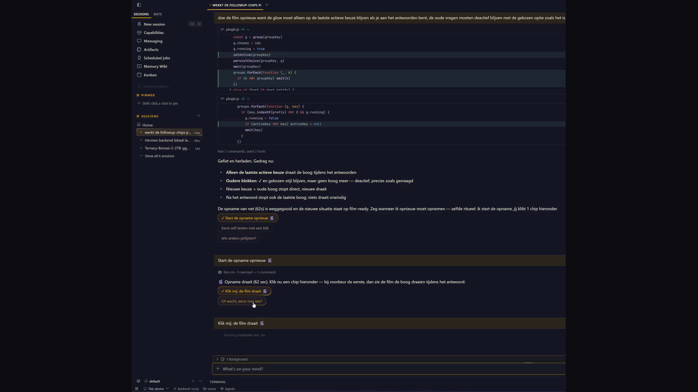

# followup-chips



Clickable follow-up suggestion chips for Hermes desktop replies. 54-second demo: `demo.mp4` (also posted with the contest entry).

## What it does

End any reply with a directive:

```
::followups{q1="First suggestion?" q2="Second one?" q3="Third?"}
```

The plugin renders each `qN` as a clickable chip under the message. One click sends that question as the next user turn — no typing.

Add `multi="1"` when several counts as one answer:

```
::followups{multi="1" q1="Add a CHANGELOG entry" q2="Wire the flag into settings" q3="Update the docs"}
```

Now the chips are toggles. Tick as many as you want and one **Send N** button sends them as a single turn, one per line, in `q` order — the agent reads it as a person asking for three things at once.

Add `rec="1,3"` to mark the options a classifier would pick:

```
::followups{multi="1" rec="1,3" q1="Push the branch" q2="Tag a release" q3="Write the notes"}
```

Those chips carry a **Recommended** tag and start out ticked, so the reply arrives one click from the steps worth taking. `rec` takes the 1-based `q` numbers, the same numbering the agent already writes.

Every chip in a block shares one width, the width of its longest option, so a row of short actions lines up instead of staggering. `accent="0"` drops the accent tint on the recommended chips and leaves everything else alone.

```
::followups{multi="1" rec="1,3" accent="0" q1="Push the branch" q2="Tag a release"}
```

### Interaction model

- **Hover** — Hermes' signature `arc-border` travelling-light ring (two-layer masked ring, themed to `--dt-primary`), subtle tint on border/background, 160 ms fades. Never a plain box-shadow.
- **Chosen, while the agent answers** — single-select: the arc keeps running on the chosen chip; the chip shows `✓` and the unchosen chips dim. Multi-select: ticked chips show `✓` and the arc runs on the **Send** button, because that is the turn being answered.
- **Answer complete** — the arc rests (driven by the real `message.complete` / `message.start` gateway events, no timers).
- **One active arc** — only the most recent choice ever runs; older blocks keep their ✓ but rest.
- **Sent blocks lock** — after Send, the button reads `✓ Sent` and the block cannot be picked again.
- **Persistent** — choices survive window reloads via `ctx.storage` (keyed `hermes.plugin.followup-chips.choices`).
- **Per-block isolation** — every `::followups` block is keyed `sessionId::directive-source`, so a new block always starts blank and never inherits an earlier choice.
- **Any count** — `q1..qN` parsed in numeric order, no hard limit. `multi="1"`, `"true"`, `"yes"` and `"on"` all enable multi-select.
- **Composer guard** — if the chat is no longer open, the click warns instead of sending into the wrong conversation.
- **Recommended** — `rec="1,3"` tags those chips and, in multi-select, ticks them once. Any tick or a sent block ends the defaults, so un-ticking a recommendation is never undone on the next render, and a reload keeps what you chose.
- **Equal widths** — the row is one grid column sized to its longest chip, so every pill stretches to that width. A very long option is capped by the row and its text wraps inside the pill. The tick slot is laid out on every chip and only hidden, so picking one does not resize the row.
- **Accent** — a recommended chip keeps the accent border and tint while it is unpicked, and the tag sits on the pill's right edge, lining up down the column. Picked chips are the strongest tint of the three states (rest, recommended, picked). With the accent setting off, the tag turns neutral grey as well, so turning it off is visible even on a chip that starts picked.

### Recommendations are optional and need the `nerve` plugin

The classifier is a separate plugin: [`nerve`](https://github.com/keeltrace/hermes-nerve), which provides `nerve_assess` (the older `jev_assess` contract is accepted too). **Install it only if you want the marks.** This plugin detects it at session start and asks for it only when it is there.

With `nerve` absent, everything else in this README works exactly as written: the agent still ends a choice with `::followups`, the chips still render and send, multi-select still ticks, blocks still persist, and `auto_offers` still converts a prose offer. The only difference is that nothing ever computes `rec`, so no chip carries the **Recommended** tag and none starts ticked.

| Installed | Chips, clicks, multi-select | Recommended tags |
|---|---|---|
| this plugin alone | yes | never |
| this plugin + `nerve` | yes | when the classifier clears the bar |

The plugin does not list `nerve` in `requires_plugins`. That field is advisory in Hermes, so the plugin would still load, but it logs a warning that a required plugin is missing, and a warning on a working install reads as breakage. The capability is probed per session instead, and `followup_recommend` answers "leave rec out" when nothing answers.

## Recommended options (agent half)

`rec` is a plain attribute: anything that writes the directive can set it. The bundled `followup_recommend` tool fills it from the decision classifier (the `nerve` plugin's `nerve_assess`, or the older `jev_assess` name of the same contract):

```
followup_recommend(options=["Push the branch", "Tag a release", "Write the notes"], context="Apo asked for the release to go out")
→ Recommended 1 of 3: 1 (0.91). Write rec="1" into the directive.
```

One `choice` question per option rides in a single classifier call (about 200 ms), so a five-option reply still costs one call. The policy is in code, not in the model: every option at or above **0.5** on "take it now" is recommended, at most 3, weakest dropped first. More than one can clear the bar, which is the point: three steps that all have to happen come back 0.81 / 0.79 / 0.77 and all three are tagged, while a reply with one obvious next step comes back 0.91 / 0.04 / 0.04 and only that one is.

When no classifier is loaded, or the owner turns **Ask the decision classifier which steps to pick** off (`auto_recommend`), the tool answers "leave rec out": no tag, no pre-pick, and nothing else about the reply changes. A classifier error never changes a reply either, so a missing, slow or broken `nerve` costs you a recommendation and never a message.

### The accent setting

**Accent the recommended options** (`accent_recommended`, on by default) is the only setting that has to travel to the renderer, and it travels as an attribute. Renderer code cannot read plugin settings: the desktop SDK exposes no settings surface to a plugin's `plugin.js`, so a toggle alone would be invisible to the chips. The agent half reads the setting on every reply and, when it is off, stamps `accent="0"` into any directive it sees:

```
::followups{rec="1" q1="Push the branch"}
↓ accent_recommended off
::followups{accent="0" rec="1" q1="Push the branch"}
```

On, nothing is added, because accented is the default. Off, a recommended chip stays on the neutral surface until you pick it, and the Recommended tag stays in the neutral grey instead of the accent. The tag changes as well because otherwise the setting would be invisible on a pre-picked chip, where the pick tint dominates. The hook that does this is the same `transform_llm_output` used by `auto_offers`: both read their setting per reply, so a toggle applies to the next turn rather than the next plugin reload. With `auto_offers` off and the accent on, the hook reads both settings and returns the reply untouched, with no text scan at all.

### Carried over proposals (agent half, off by default)

A reply's chips only exist while that reply is on screen. In a long queued session the next reply buries them, and a step you never answered is gone.

**Carry Over Old Proposals** (`carry_over`, off by default) keeps them. Every reply then also draws the proposals earlier replies left unanswered. Each carried chip says how far back it came from (`2 responses ago`) and carries an **✕** at its end to drop it; clicking the age jumps the transcript back to the reply that offered it.

| Reply | Proposes | Shows |
|---|---|---|
| 1 | three steps | its three |
| 2 | nothing | the same three, each saying `1 response ago` |
| 3 | two steps | its two, then the same three |

Picking a chip sends it as the turn and retires it. Picking anything in a block retires that whole block, because a reply you answered is not a proposal any more. The ✕ retires one chip and sends nothing, and the age badge scrolls without sending: the pill, the age and the ✕ are three separate targets, because a label that looks like a link but sends a message is a trap. The count is not an estimate: every reply in a carrying session takes the next number when its chips first mount, the numbers are stored with the queue, and a chip's age is the difference between its reply and the one you are reading. The queue is per session, capped at 30 entries, and survives a window reload; dismissing is permanent, so a reload cannot bring a dropped chip back.

Two mechanics are worth knowing, because both come from the plugin's split halves:

- Renderer code cannot read plugin settings, so the agent half stamps `carry="1"` into the directive.
- A reply that proposes nothing still needs a slot to draw in. The directive paragraph is the only place a desktop plugin can render, so with the setting on the agent half appends one empty `::followups{carry="1"}` line to a reply that proposes nothing. With nothing to carry and nothing proposed, that line renders as nothing at all, and no chips line appears.

Because that empty block is a rewrite of the reply text, it applies on Desktop only; other surfaces never see the directive.

## The prompt rule (agent half)

A directive only appears if the model writes it. So the plugin registers one system-prompt section (`prompt_section.py`) telling the agent: when the next step is a choice, end with the directive instead of asking in prose. It forbids the phrases that leave a reply dead-ended — "say the word and I'll…", "want me to…?", "shall I…?", "let me know if…" — and asks for 2 to 5 imperative options. On surfaces that cannot draw chips (Telegram, the CLI) the section asks for a numbered list instead, so no raw directive line is ever printed there.

Nothing is sent anywhere; the section is text frozen into the session prompt.

### Optional: the offer you already got

Models do not always follow a rule. With **Turn a written offer into chips** on (Settings → Plugins, `auto_offers`, off by default) a `transform_llm_output` hook reads the closing paragraph of each reply, and when it is an offer it moves it into a directive before the reply is stored:

```
Branch is pushed and the PR is open.

Want me to take any of these next?
- Add a CHANGELOG entry
- Update the docs screenshot
```

becomes

```
Branch is pushed and the PR is open.

::followups{multi="1" q1="Add a CHANGELOG entry" q2="Update the docs screenshot"}
```

`offers.py` is pure text in, text out: no network, no model call. It only looks at the **last** paragraph, only for a recognised offer phrase plus a bullet list or a single offer sentence, and it returns the reply untouched on any other shape — a statement of intent ("I'll check the log first"), a mid-reply question ("Want me to push it?" followed by more prose), a conditional clause ("the rule fires if you want strict mode"), a reply that already carries a directive, and every non-Desktop surface. Quotes are rewritten, braces are stripped, options cap at 6 and 120 characters. A false negative costs nothing; a false positive would rewrite someone's prose, so the bar is deliberately high.

## Why a plugin (and not a prompt/skill)

A skill can emit text; it cannot render interactive UI in the transcript, wire click→composer-submit, host a state machine per directive instance, subscribe to gateway events, or persist UI state across reload. This is transcript-directive rendering + session-scoped state — desktop-plugin territory. And a prompt alone cannot fix the replies that ignore it, which is what the optional hook is for.

## Files

- `desktop/plugin.js` — the renderer (default export `{ id, register }`), the copy the manifest entrypoints
- `plugin.js` — the same file for single-file installs; `tests/chips.test.mjs` fails if the two drift
- `__init__.py` — the agent half: the prompt section, the recommend tool, the optional `transform_llm_output` hook
- `prompt_section.py` — the chip rule, per surface, with the classifier sentence when one is loaded
- `offers.py` — the closing-offer detector
- `recommend.py` — `followup_recommend`: the classifier call and the pick policy
- `plugin.yaml` — manifest, `provides_tools` / `provides_hooks`, and the four settings: `auto_offers`, `auto_recommend`, `accent_recommended`, `carry_over`
- `tests/` — detector, carry stamp, recommendation and registration tests (Python), renderer harness (Node, no dependencies)

## Install

Both halves, as one plugin:

```
git clone https://github.com/nuonrg/hermes-plugin-followup-chips
hermes plugins install ./hermes-plugin-followup-chips
```

Or by hand: copy the folder to `%LOCALAPPDATA%/hermes/plugins/followup-chips/` and enable it in Settings → Plugins. Reload with `Ctrl+R`.

Desktop-only install (chips, no prompt rule, no hook): copy `plugin.js` to `%LOCALAPPDATA%/hermes/desktop-plugins/followup-chips/plugin.js` and reload.

## Tests

```
python -m unittest discover -s tests -t .   # 76 tests: detector, carry stamp, recommendation, hook, registration
node tests/chips.test.mjs                   # 32 cases: renderer, carry queue, with stub SDK and React
```

## Catalog entry (plugin-catalog/followup-chips.yaml)

```yaml
name: followup-chips
description: >-
  Clickable follow-up question chips under assistant replies. One click sends
  the question as the next turn; with multi="1" several chips are ticked and
  sent as one message, and a bundled prompt rule makes the agent end a choice
  with the chips instead of asking "say the word and I'll...". An optional hook
  turns an offer written in prose into the same chips. Hermes arc-border hover;
  choice persists per block across reload.
repo: https://github.com/nuonrg/hermes-plugin-followup-chips
sha: <40-char commit SHA of the pinned release>
capabilities:
  provides_tools: [followup_recommend]
  provides_hooks: [transform_llm_output]
```

No self-updating code, no core patches, no native binaries — the plugin only uses the public desktop SDK (`TRANSCRIPT_DIRECTIVE_AREA`, `host.composer.submit`, `ctx.storage`, `ctx.onEvent`) and public plugin APIs (`register_system_prompt_section`, `register_hook`, `get_config`).

## Credits

Built by **@nuonrg** for the Hermes Agent Plugin Hackathon (Nous Research, Nov 2026).
