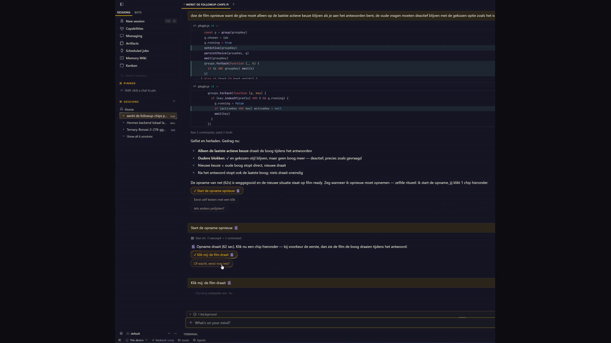

# followup-chips



Clickable follow-up suggestion chips for Hermes desktop replies. 54-second demo: `demo.mp4` (also posted with the contest entry).

## What it does

End any reply with a directive:

```
::followups{q1="First suggestion?" q2="Second one?" q3="Third?"}
```

The plugin renders each `qN` as a clickable chip under the message. One click sends that question as the next user turn — no typing.

### Interaction model

- **Hover** — Hermes' signature `arc-border` travelling-light ring (two-layer masked ring, themed to `--dt-primary`), subtle tint on border/background, 160 ms fades. Never a plain box-shadow.
- **Chosen, while the agent answers** — the arc keeps running on the chosen chip; the chip shows `✓` and the unchosen chips dim.
- **Answer complete** — the arc rests (driven by the real `message.complete` / `message.start` gateway events, no timers).
- **One active arc** — only the most recent choice ever runs; older blocks keep their ✓ but rest.
- **Persistent** — choices survive window reloads via `ctx.storage` (keyed `hermes.plugin.followup-chips.choices`).
- **Per-block isolation** — every `::followups` block is keyed `sessionId::directive-source`, so a new block always starts blank and never inherits an earlier choice.
- **Any count** — `q1..qN` parsed in numeric order, no hard limit.

## Why a plugin (and not a prompt/skill)

A skill can emit text; it cannot render interactive UI in the transcript, wire click→composer-submit, host a state machine per directive instance, subscribe to gateway events, or persist UI state across reload. This is transcript-directive rendering + session-scoped state — desktop-plugin territory.

## Files

- `plugin.js` — the entire plugin (single file, default export `{ id, register }`)
- `followup-chips-contest.mp4` — 54 s demo, 1920×1080, English VO

## Install (dev)

Copy `plugin.js` to `%LOCALAPPDATA%/hermes/desktop-plugins/followup-chips/plugin.js` and reload Hermes (`Ctrl+R`).

## Catalog entry (plugin-catalog/followup-chips.yaml)

```yaml
name: followup-chips
description: >-
  Clickable follow-up question chips under assistant replies. One click sends
  the question as the next turn; Hermes arc-border hover; choice persists per
  block across reload. Single-file desktop plugin, no native components.
repo: https://github.com/nuonrg/hermes-plugin-followup-chips
sha: <40-char commit SHA of the pinned release>
capabilities: []
```

No self-updating code, no core patches, no native binaries — capabilities list is empty by design; the plugin only uses the public desktop SDK (`TRANSCRIPT_DIRECTIVE_AREA`, `host.composer.submit`, `ctx.storage`, `ctx.onEvent`).

## Credits

Built by **@nuonrg** for the Hermes Agent Plugin Hackathon (Nous Research, Nov 2026).
